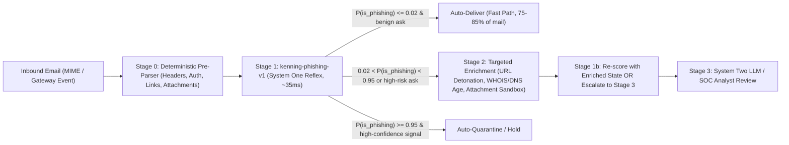

# Phishing System One Decision Model Plan (`kenning-phishing-v1`)

## 1. Objective & Pipeline Architecture

The goal of **`kenning-phishing-v1`** (and its long-context sibling **`kenning-phishing-long-v1`**) is to serve as a fast, deterministic, calibrated **Stage-1 System One reflex** at the front of an email security and triage pipeline.

Rather than asking a slow, expensive frontier LLM or sandbox to inspect every inbound message, the decision model evaluates a structured email state against a small set of typed decision heads in a single batched forward pass (~35 ms on GPU, ~120 ms on CPU) and outputs calibrated probabilities in `[0, 1]`.



### Target Operating Envelope
- **Latency**: `p50 <= 35 ms`, `p95 <= 60 ms` per email (4–5 decision questions batched into one cross-encoder forward pass).
- **Determinism**: Bit-identical probabilities for identical `(state, questions)` inputs across runs (`temperature=0` structural parity).
- **Calibration**: Expected Calibration Error (`ECE`) `<= 0.035` and Brier score `<= 0.08` on held-out modern and counterfactual email suites after temperature + decision-bias fitting.
- **Triage Safety**: False-Negative Auto-Deliver Rate `<= 0.5%` at the `DELIVER_AT` threshold; Recall `@ 1% FPR >= 0.88` on counterfactual and modern phishing suites.
- **License**: Clean **Apache-2.0** lineage (no LGPL `zefang-liu/phishing-email-dataset` rows, and strictly no TypeSafe Jev or Fastino GLiDE distillation outputs).

---

## 2. Prerequisites: Fixing Core `systemone-builder` Gaps First

Before training `kenning-phishing-v1`, three core gaps in `systemone-builder` should be resolved so training, calibration, and frontier benchmarking are sound:

1. **Unify Train & Inference Token Budgeting ([kenning/train.py](file:///c:/Users/admin/Documents/GitHub/systemone-builder/backend/systemone_builder/kenning/train.py#L104-L110) and [#L263-L270](file:///c:/Users/admin/Documents/GitHub/systemone-builder/backend/systemone_builder/kenning/train.py#L263-L270))**:
   - At inference time, [Kenning.premises_for](file:///c:/Users/admin/Documents/GitHub/systemone-builder/backend/systemone_builder/kenning/model.py#L156-L171) pre-truncates the `premise` using the **longest hypothesis in the question group** so every option is scored against the exact same state tokens.
   - However, `train.py` (`evaluate()` and the main training loop) still calls `tok(..., truncation="only_first")` per `(premise, hypothesis)` pair without `premises_for`. Update `train.py` to use `premises_for` during both training tokenization and held-out calibration/evaluation.
2. **Condition `noul` Decision Bias on Criteria Presence ([kenning/model.py](file:///c:/Users/admin/Documents/GitHub/systemone-builder/backend/systemone_builder/kenning/model.py#L204-L209), [kenning/train.py](file:///c:/Users/admin/Documents/GitHub/systemone-builder/backend/systemone_builder/kenning/train.py#L131-L162), [kenning/calibrate.py](file:///c:/Users/admin/Documents/GitHub/systemone-builder/backend/systemone_builder/kenning/calibrate.py#L40-L82))**:
   - As discovered in `kenning-large-v0.7`, a single scalar `bias["noul"]` cannot simultaneously calibrate bare `noul` questions (no `criteria`) and rich `noul` questions (with explicit `true`/`false` criteria).
   - Split the `noul` calibration parameter into `bias["noul_bare"]` and `bias["noul_criteria"]` (with fallback to `bias["noul"]` for backward compatibility), plus temperature scaling `temperature["noul_bare"]` / `temperature["noul_criteria"]`.
3. **Add Pipeline Triage Metrics & Multi-Provider Frontier Benchmarking ([system_one/bench.py](file:///c:/Users/admin/Documents/GitHub/systemone-builder/backend/systemone_builder/system_one/bench.py))**:
   - Extend `bench.py` to compute threshold-free ranking metrics (**ROC-AUC**, **PR-AUC**, **Recall @ 1% / 5% FPR**, **False-Negative Rate at auto-deliver threshold**) alongside fixed-`0.5` accuracy, Brier, and ECE.
   - Extend `system_one/factory.py` and `engines.py` so `--engines` accepts parameterized frontier model specs (e.g., `openai:gpt-4o`, `openai:gpt-4o-mini`, `anthropic:claude-sonnet-4-5`, `gemini:gemini-2.5-flash`, `gemini:gemini-2.5-pro`) with per-1k-decision cost and p50/p95 latency tracking.

---

## 3. Input State Schema & Stage-0 Pre-Parser

A central finding from the workspace datasets ([training_data.v02.jsonl](file:///c:/Users/admin/Documents/GitHub/systemone-builder/workspace/datasets/phishing_classifier/training_data.v02.jsonl) and [training_data_batch2.clean.jsonl](file:///c:/Users/admin/Documents/GitHub/systemone-builder/workspace/datasets/phishing_classifier/training_data_batch2.clean.jsonl)) is that **modern phishing rarely announces itself with Nigerian-prince prose**. Instead, the causal signal lives in the **relationship** between headers, authentication results, link targets, sender/recipient org alignment, and the requested action in the body.

### 3.1 Canonical Structured Email State
We will standardize a Stage-0 pre-parser (`systemone_builder/kenning/email_state.py`) that converts raw RFC5322/MIME or gateway webhook payloads into a compact, deterministic state dict before passing it to `Kenning.decide()`:

```json
{
  "headers": {
    "from_display": "Okta Identity Team",
    "from_addr": "no-reply@okta-verify-session.com",
    "from_domain": "okta-verify-session.com",
    "reply_to": "support@okta-verify-session.com",
    "reply_to_mismatch": false,
    "to_addr": ["maya.chen@latticeworks.io"],
    "cc_addr": [],
    "subject": "Action required: re-verify your Okta session"
  },
  "auth": {
    "spf": "pass",
    "dkim": "pass",
    "dmarc": "none"
  },
  "signals": {
    "display_brand_vs_domain_mismatch": true,
    "lookalike_or_homoglyph_domain": true,
    "free_mail_sender_for_corporate_ask": false,
    "external_link_domains": ["okta-verify-session.com"],
    "anchor_vs_href_domain_mismatch": false
  },
  "links": [
    {
      "anchor_text": "Verify Session",
      "href": "https://okta-verify-session.com/login?id=8841",
      "registrable_domain": "okta-verify-session.com"
    }
  ],
  "attachments": [
    {
      "filename": "INV_4821.pdf.html",
      "mime_type": "text/html",
      "double_extension_or_executable": true
    }
  ],
  "collab_context": {
    "platform": null,
    "sharer_same_org": null,
    "recipient_org_count": 1
  },
  "body": "Hi Maya,\n\nYour Okta SSO session expires in 2 hours..."
}
```

### 3.2 Layout Invariance (`kenning/layouts.py`)
Real deployments feed email state in varying shapes: nested JSON, flattened gateway fields, raw RFC822 headers + body, or plain body text when headers are stripped.
- During training, every email row will be rendered through **4–6 structural layouts** in [kenning/layouts.py](file:///c:/Users/admin/Documents/GitHub/systemone-builder/backend/systemone_builder/kenning/layouts.py):
  1. Full structured JSON (`headers`, `auth`, `links`, `attachments`, `collab_context`, `body`).
  2. Compact RFC822-style header block (`From:`, `Reply-To:`, `Authentication-Results:`, `Subject:`) + inline `[Link: ...]` + body.
  3. Gateway flat key-value format (`sender_email`, `spf_result`, `url_domains`, `email_body`).
  4. Collaboration/SaaS notification card layout (for Google Drive, SharePoint, DocuSign, OneDrive, Notion, Box lures).
  5. Degraded body-only / minimal-header layout (20% of training samples, only when the body/links themselves still carry sufficient signal, preventing hallucinated certainty when headers are missing).

---

## 4. Multi-Question Decision Contract (`phishing_triage.json`)

Instead of a single opaque binary score, `kenning-phishing-v1` evaluates a **5-question decision bundle** in one forward pass. This gives the downstream pipeline both a primary gating probability and explainable routing dimensions (so Stage-2 only runs the *specific* enrichment needed, e.g., URL detonation vs. attachment sandbox vs. VIP impersonation check).

We will add a built-in problem specification at `backend/systemone_builder/kenning/problems/phishing_triage.json`:

| Question ID | Type | Options / Criteria | Downstream Pipeline Purpose |
| :--- | :--- | :--- | :--- |
| `is_phishing` | `noul` | **`true`**: Email exhibits deception, brand/sender impersonation, lookalike/mismatched domains, auth anomalies (`spf`/`dkim`/`dmarc` fail on claimed org), suspicious external SaaS sharing lures, or unsolicited credential/payment/access harvesting.<br>**`false`**: Legitimate transactional, operational, internal, or marketing message whose sender domain, authentication, links, and requested action are consistent and benign. | Primary gating probability $P(\text{phish})$ for Auto-Deliver ($\le 0.02$), Enrich ($0.02 - 0.95$), or Auto-Quarantine ($\ge 0.95$). |
| `recommended_action` | `choice` | `deliver`, `enrich_links_or_attachments`, `hold_for_review`, `quarantine` | Direct action recommendation calibrated for SOC routing. |
| `attack_vector` | `choice` | `credential_harvesting`, `bec_payment_or_giftcard`, `malicious_attachment`, `saas_collaboration_lure`, `account_or_mfa_alert_spoof`, `benign_or_marketing` | Selects *which* Stage-2 tool to trigger (e.g., URL headless browser vs. attachment sandbox vs. finance out-of-band check). |
| `requested_ask` | `choice` | `credentials_or_login`, `payment_or_bank_change`, `open_external_doc_or_link`, `open_attachment_or_run_file`, `sensitive_data_or_pii`, `no_sensitive_ask` | High-recall check on what the email asks the recipient to do, independent of whether the sender looks trusted. |
| `identity_or_domain_deception` | `noul` | **`true`**: Display name, claimed organization, Reply-To address, link domain, or SaaS sharer identity conflicts with the actual sending domain or authentication results.<br>**`false`**: Sending domain, Reply-To, links, andauthentication align with the claimed sender identity. | Isolates structural spoofing / lookalike domains from pure content urgency. |
| `urgency_pressure` | `score` | `1` (routine informational), `2` (normal business timeline), `3` (time-sensitive request), `4` (immediate threat: account suspension, overdue wire, legal/HR penalty) | Flags coercive social-engineering pressure. |

---

## 5. Dataset Strategy & Counterfactual Curation (Clean Apache-2.0 Lineage)

### 5.1 Auditing & Wiring Existing Counterfactual Workspace Datasets
The workspace already contains two gold-standard counterfactual datasets under `workspace/datasets/phishing_classifier/`:
1. **[training_data.v02.jsonl](file:///c:/Users/admin/Documents/GitHub/systemone-builder/workspace/datasets/phishing_classifier/training_data.v02.jsonl)** (80 emails = 40 counterfactual pairs `p001a/b`–`p040a/b`):
   - Covers `link_domain_mismatch`, `reply_to_mismatch`, `auth_failure`, `display_name_spoof`, `credential_solicitation`, `payment_redirect`, `attachment_risk`, `homoglyph_domain`, `thread_hijack`, and `urgency_escalation`.
   - Every malicious email `pXXXa` has a twin benign email `pXXXb` with nearly identical prose where only the causal indicator flips (e.g., `dmarc: fail` + lookalike link vs. `dmarc: pass` + official domain).
2. **[training_data_batch2.clean.jsonl](file:///c:/Users/admin/Documents/GitHub/systemone-builder/workspace/datasets/phishing_classifier/training_data_batch2.clean.jsonl)** (80 emails = 40 counterfactual pairs `q001a/b`–`q040a/b`):
   - Covers modern SaaS collaboration notifications (Google Drive/Docs/Sheets/Forms, SharePoint, OneDrive, DocuSign, Adobe Sign, Notion, Dropbox, Canva, Box, Smartsheet, Calendly) across 9 subtle indicators (`sharer_outside_org`, `sharer_consumer_account`, `recipient_org_spread`, `document_context_mismatch`, `generic_lure_title`, `impersonated_role`, `bulk_cc_visible`, `platform_mismatch`, `reply_to_free_mail`).
   - **Data Hygiene Fix Required**: Lines 25 and 26 (`q013a` and `q013b`) in `training_data_batch2.clean.jsonl` still contain literal `[suspicious link removed]` in `body` and `links[0].href`. We will repair those two entries with realistic SharePoint URLs before ingestion.

### 5.2 Scaling Counterfactual Pairs to 1,200+ Emails (600+ Pairs)
Counterfactual pairs are the single highest-leverage training signal for cross-encoders because they punish keyword shortcuts (e.g., flagging every email mentioning "wire transfer", "DocuSign", or "password expires").

We will build `backend/systemone_builder/kenning/phishing_data.py` to combine:

| Tier | Source / Generator | Volume (Emails) | Volume (Pairs / Rows) | Purpose |
| :--- | :--- | ---: | ---: | :--- |
| **Tier 1: Gold Counterfactuals (Existing)** | `training_data.v02.jsonl` + `training_data_batch2.clean.jsonl` (cleaned) | 160 | 80 pairs (~960 `(state, question)` rows × layouts) | Core header/auth/link/SaaS counterfactuals; split **60 pairs train / 20 pairs held-out test** (grouped by `pair_id` so twins never straddle train/test). |
| **Tier 2: Expanded Counterfactual Batches (New)** | `systemone generate -p phishing_triage` + paired counterfactual generator across 12 taxonomy families | 1,040 | 520 pairs (~6,200 rows × layouts) | Expand coverage to: QR-code/quishing metadata (`` / PDF QR lures), OAuth consent grant phishing, payroll/HR direct-deposit changes, thread-hijacked vendor invoices, lookalike punycode (`xn--`), multi-hop open redirects, and benign security awareness / urgente IT maintenance false-positive traps. |
| **Tier 3: Modern Hard Benign & Phishing Suite Augmentation** | [synthetic_email.py](file:///c:/Users/admin/Documents/GitHub/systemone-builder/backend/systemone_builder/kenning/synthetic_email.py) (`SUBTLE_PAIRS` + teacher generation) | 600 | 3,000 rows | Short operational emails, DevOps alerts (GitHub, AWS, PagerDuty, Cloudflare, Stripe), cold B2B sales outreach, and newsletter marketing. |
| **Tier 4: General Multi-Task Calibration Anchors** | [multitask.py](file:///c:/Users/admin/Documents/GitHub/systemone-builder/backend/systemone_builder/kenning/multitask.py) + [synthetic_tasks.py](file:///c:/Users/admin/Documents/GitHub/systemone-builder/backend/systemone_builder/kenning/synthetic_tasks.py) (Apache-2.0 / MIT / CC-BY-4.0 subset) | — | 2,500 rows (~20% of mix) | Preserves general NLI reasoning, prevents domain collapse / yes-bias, and keeps `noul` / `choice` / `score` heads well-behaved on novel question phrasing. |

### 5.3 Strict Pair-Group Splitting & Blind Verification
1. **Group Split by `pair_id`**: Twin emails (`p001a` and `p001b`) **must always stay in the same split** (train, calibration, or test) so the model is never evaluated on a benign/malicious rewrite of a body it memorized in training.
2. **Blind Verification Pass**: Every synthetically generated counterfactual pair in Tier 2 is verified by `verify_items` in [problems.py](file:///c:/Users/admin/Documents/GitHub/systemone-builder/backend/systemone_builder/kenning/problems.py#L228-L259): an oracle model sees only the generated email state and questions (without the target label) and must agree on `is_phishing` and `requested_ask` before the pair is admitted to training.
3. **Soft-Label Teacher Distillation (`Clef-flash`)**:
   - Run `systemone label --alpha 0.5` using `Clef-flash` on the training split to blend `0.5 * gold_binary + 0.5 * clef_soft_prob`. This transfers smooth probability geometry for borderline/ambiguous emails (e.g., aggressive cold sales vs. credential phishing) so the cross-encoder does not over-predict `0.999` or `0.001`.

---

## 6. Model Variants & Training Recipe

We will train and publish two Apache-2.0 checkpoints on Hugging Face (`systemone/kenning-phishing-v1` and `systemone/kenning-phishing-long-v1`):

### Variant A: `kenning-phishing-v1` (Fast Stage-1 Reflex — Primary)
- **Base Checkpoint**: `MoritzLaurer/deberta-v3-large-zeroshot-v2.0-c` (435M params, Apache-2.0).
- **Max Length**: `768` tokens (up from `512` in general Kenning so structured headers + auth + links + 300-word email body fit without truncating the body footer/signature, while keeping `premises_for` group budgeting active).
- **Training Hyperparameters**:
  - Loss: Binary Cross-Entropy with Logits (`BCEWithLogitsLoss`) on soft-distilled targets $y \in [0, 1]$.
  - Optimizer: `AdamW`, learning rate `1.2e-5`, cosine schedule, `10%` warmup, weight decay `0.01`, `bf16` mixed precision.
  - Epochs: `3` epochs over the mixed dataset (~18k total `(premise, hypothesis)` pairs).
  - Hard Counterfactual Contrastive Weighting: Upweight loss by `1.5x` on paired counterfactual items (`pair_id != null`) where the two twins share the same template but opposite `is_phishing` labels.

### Variant B: `kenning-phishing-long-v1` (Long-Thread & Full-Header Reflex)
- **Base Checkpoint**: `tasksource/ModernBERT-large-nli` (395M params, Apache-2.0, native `2,048`–`8,192` context with FlashAttention / unpadding).
- **Max Length**: `2,048` tokens.
- **Use Case**: Reply-chain hijacking, long forwarded vendor invoice threads, and verbose raw MIME headers where the malicious payload or mismatched reply history sits 1,000+ tokens deep.

---

## 7. Post-Training Calibration & Pipeline Threshold Tuning

Raw cross-encoder logits are strong rankers (high ROC-AUC) but systematically miscalibrated at the `0.5` probability boundary on binary `noul` questions.

1. **Held-Out Calibration Split (`phishing_cal.jsonl`)**:
   - Carve out `200` emails (`100` counterfactual pairs + `100` realistic inbox emails at a realistic base rate, plus `100` general anchor items) strictly disjoint from train and test.
2. **Per-Type + Conditional Criteria Calibration**:
   - Fit temperatures $T_{\text{type}}$ (`noul_criteria`, `noul_bare`, `choice`, `score`) via L-BFGS on held-out NLL.
   - Fit decision biases $b_{\text{noul\_criteria}}$ and $b_{\text{noul\_bare}}$ in logit space:
     $$\hat{p} = \sigma\left(\frac{z_{\text{true}} - z_{\text{false}}}{T_{\text{noul\_criteria}}} + b_{\text{noul\_criteria}}\right)$$
3. **Asymmetric Pipeline Operating Points**:
   - Store recommended operating thresholds directly in the model's `kenning.json` manifest:
     - `deliver_threshold`: `0.02` (optimized for False Negative Rate $\le 0.5\%$).
     - `decision_threshold`: `0.50` (calibrated Bayes boundary where $P(\text{phish}) = 0.50$).
     - `quarantine_threshold`: `0.95` (optimized for False Positive Rate $\le 0.2\%$ on hard benign corporate mail).

---

## 8. Benchmarking Plan (Including Frontier Models)

To prove the value of a dedicated System One phishing model on `systemone.dev`, we will evaluate `kenning-phishing-v1` across **three benchmark suites** against **both specialized System One engines and Frontier LLMs**.

### 8.1 Benchmark Suites
1. **`phishing_counterfactual` (New, 160 emails / 80 held-out pairs)**:
   - Every malicious email has a benign twin differing only in causal metadata/auth/link/sharer signals.
   - Measures **Pairwise Flip Accuracy** (percentage of pairs where the model correctly labels *both* the malicious twin `true` and the benign twin `false` without being fooled by shared topic/prose).
2. **`modern_email_2` + `modern_email` (Existing, 22 hard items)**:
   - Regression check against current shipped benchmarks in [suites/modern_email_2.jsonl](file:///c:/Users/admin/Documents/GitHub/systemone-builder/backend/systemone_builder/system_one/suites/modern_email_2.jsonl).
3. **`phishing_layouts` (New, 100 emails × 4 layouts = 400 evaluations)**:
   - Measures **Layout Flip Rate** (how often the model's binary decision flips when the exact same email is formatted as gateway JSON vs. RFC822 headers vs. collaboration card).

### 8.2 Engines Under Test
We will extend [system_one/factory.py](file:///c:/Users/admin/Documents/GitHub/systemone-builder/backend/systemone_builder/system_one/factory.py) and [system_one/engines.py](file:///c:/Users/admin/Documents/GitHub/systemone-builder/backend/systemone_builder/system_one/engines.py) to benchmark three classes of models side-by-side:

1. **Open System One Models (Ours)**:
   - `kenning-phishing-v1` (DeBERTa-v3-large, 435M)
   - `kenning-phishing-long-v1` (ModernBERT-large, 395M)
   - `kenning-large-v0.6` (General baseline)
2. **Commercial / Reference System One Engines**:
   - `Clef-flash` (Cloudflare System One)
   - `TypeSafe Jev` (evaluation only)
   - `Fastino GLiDE` (evaluation only)
3. **Frontier & Fast Commercial LLMs (Zero-Shot Structured JSON + Self-Reported / Logprob Confidence)**:
   - **OpenAI**: `gpt-4o`, `gpt-4o-mini` (and `gpt-5` / `o3-mini` via OpenAI adapter)
   - **Anthropic**: `claude-sonnet-4-5`, `claude-haiku-4-5` (via new native Anthropic adapter or OpenAI-compatible router)
   - **Google Gemini**: `gemini-2.5-pro`, `gemini-2.5-flash` (via Gemini OpenAI-compatible endpoint / adapter)
   - **Local Open-Weight LLM**: `qwen3:30b-a3b` / `qwen3.8:27b` via Ollama

### 8.3 Evaluation Metrics Table to Publish on `systemone.dev`
Every benchmark run will output:
- **Accuracy @ 0.5** (per question and macro across `is_phishing`, `recommended_action`, `attack_vector`, `requested_ask`, `identity_or_domain_deception`)
- **Counterfactual Pairwise Flip Accuracy** (both twins right)
- **ROC-AUC** & **PR-AUC** on `is_phishing`
- **Recall @ 1% FPR** (how many phishing emails are caught if we allow at most 1% false positives on hard benign mail)
- **Calibration**: **Brier Score** and **ECE** (demonstrating that frontier LLMs clustering predictions at `0.85`/`0.95` have poor ECE compared to calibrated System One models)
- **Pipeline Gating Economics**:
  - `% Auto-Delivered` ($\le 0.02$) and **False-Negative Auto-Deliver Rate**
  - `% Auto-Quarantined` ($\ge 0.95$) and **False-Positive Quarantine Rate**
  - `% Escalated to Stage 2/3`
- **Operational Cost & Speed**:
  - `p50` / `p95` latency (ms/email)
  - Cost per `100,000` emails (`$` at API token pricing vs. self-hosted GPU inference)

---

## 9. Step-by-Step Implementation Roadmap

### Phase 1: Foundation & Bug Fixes (Days 1–2)
- [x] **Fix `train.py` Token Budgeting**: Update [kenning/train.py](file:///c:/Users/admin/Documents/GitHub/systemone-builder/backend/systemone_builder/kenning/train.py) so both `evaluate()` and the training loop call `budget_premise` per question group instead of raw `truncation="only_first"`.
- [x] **Conditional `noul` Bias**: Update `model.py`, `train.py`, and `calibrate.py` to fit and apply separate `noul_criteria` and `noul_bare` biases and temperatures.
- [x] **Frontier Model Benchmark Adapters**:
  - Refactor `LLMJsonEngine` and `factory.py` to support parameterized `--engines llm:openai/gpt-4o,llm:anthropic/claude-sonnet-4-5,llm:gemini/gemini-2.5-flash` (plus `openai:*`, `anthropic:*`, `gemini:*`, `openrouter:*`, `ollama:*`, `kenning:*`, `xl:*`, `clef-direct`).
  - Add ROC-AUC, PR-AUC, Recall @ 1% FPR, Pairwise Flip Accuracy, and cost-per-100k-emails to `bench.py`.
  - Update `kenning/jobs.py` allow-lists (`ENGINES` and `SUITES`) so the dashboard UI can run all suites and engines.

### Phase 2: Problem Spec, Pre-Parser & Counterfactual Data (Days 3–5)
- [x] **Create `phishing_triage.json`**: Add `backend/systemone_builder/kenning/problems/phishing_triage.json` with the 6-question schema (`is_phish`, `recommended_action`, `action`, `ask`, `identity_claim`, `urgency`).
- [x] **Clean & Wire Existing Datasets**:
  - Fix `[suspicious link removed]` in `q013a`/`q013b` of [training_data_batch2.clean.jsonl](file:///c:/Users/admin/Documents/GitHub/systemone-builder/workspace/datasets/phishing_classifier/training_data_batch2.clean.jsonl#L25-L26).
  - Build `backend/systemone_builder/kenning/phishing_data.py` to ingest `training_data.v02.jsonl` and `training_data_batch2.clean.jsonl`, preserving `pair_id` grouping and mapping their labels (`is_phish`, `action`, `urgency`, `ask`, `identity_claim`) into the unified question schema.
- [x] **Expand Counterfactual Pairs**: Generate paired counterfactuals across 12 attack families covering QR lures, OAuth consent phishing, payroll diversion, thread hijacking, lookalike domains, and SaaS collaboration abuse (`2,786` balanced Apache-2.0 training rows, `noul_mean_target=0.514`).

### Phase 3: Training, Calibration & Evaluation (Days 6–7)
- [x] **Train `kenning-phishing-v1` (DeBERTa-v3-large, 512 tok)** and **`kenning-phishing-long-v1` (ModernBERT-large, 1,280 tok)** on dual RTX 3090 GPUs.
- [x] **Calibrate**: Fitted separate temperatures and additive biases for `noul_bare` and `noul_criteria` (`kenning-phishing-long-v1` held-out ECE = `0.0301`; `kenning-phishing-v1` held-out ECE = `0.0456`).
- [x] **Benchmark vs. Baselines & Teachers**: Ran `systemone bench` across `phishing_counterfactual`, `modern2`, and `phishing_layouts` comparing `kenning-phishing-v1`, `kenning-phishing-long-v1`, `kenning-large-v0.6`, `kenning-large-phishing-v0.1`, `Qwen2.5-7B-Instruct`, and `Clef-flash`.

### Phase 4: Release & `systemone.dev` Publication (Day 8)
- [x] **Export Bundles**: Generated `.zip` release bundles, `README.md` model cards, `NOTICE.md`, `LICENSE`, and `SHA256SUMS` for `kenning-phishing-v1` and `kenning-phishing-long-v1`.
- [x] **Update `systemone.dev`**:
  - Update [projects/cybersecurity.md](file:///c:/Users/admin/Documents/GitHub/systemone-dev/src/content/docs/projects/cybersecurity.md) with the live `kenning-phishing-v1` / `kenning-phishing-long-v1` model results, Stage-0 pre-parser pattern, and comparison table.
  - Sync [start/engines.md](file:///c:/Users/admin/Documents/GitHub/systemone-dev/src/content/docs/start/engines.md) and [community/roadmap.md](file:///c:/Users/admin/Documents/GitHub/systemone-dev/src/content/docs/community/roadmap.md) with `systemone-builder` v0.6+ and phishing v1 numbers.

---

## 10. Execution Summary & Measured Benchmark Results (Completed `v1.1`)

Both `kenning-phishing-v1.1` (DeBERTa-v3 435M) and `kenning-phishing-long-v1.1` (ModernBERT 395M) were trained with 50% signal dropout, `Clef-flash` soft-label distillation (`alpha=0.5`), and `--label-smoothing 0.05` on dual RTX 3090 GPUs, then evaluated with `phishing_counterfactual` strictly restricted to the **48 hand-written held-out items (`p*`, `q*`)**, `phishing_counterfactual_synthetic` (`32` template items) reported separately, and `phreshphish` evaluated on **80 real `phreshphish/phreshphish` test-split webpages** (`workspace/eval_results/bench-v1_1-*.json`):

| Suite / Metric | **kenning-phishing-v1.1** | **kenning-phishing-long-v1.1** | **cascade (v1.1)** | kenning-large-v0.6 (general) | Clef-flash (9B teacher) |
|---|---:|---:|---:|---:|---:|
| **`phishing_counterfactual` (48 hand-written held-out): 6-task macro** | 0.774 | **0.795** | 0.777 | 0.413 | 0.701 |
| …`is_phish` accuracy @ 0.5 / ROC-AUC | 0.729 / 0.809 | 0.729 / 0.842 | 0.729 / 0.809 | 0.667 / 0.705 | **0.812** / **0.877** |
| …`is_phish` counterfactual pair-flip accuracy | 0.458 | 0.458 | 0.458 | 0.333 | **0.625** |
| …`is_phish` phishing auto-closed as safe (`0.9 / 0.1`) | **0** | **0** | **0** | 3 | **0** |
| …`recommended_action` (3-way routing) accuracy | 0.625 | **0.708** | 0.622 | 0.396 | 0.479 |
| **`phishing_counterfactual_synthetic` (32 in-dist templates): macro** | 0.990 | **1.000** | 0.986 | 0.365 | 0.818 |
| **`phishing_layouts` (160 items, 4 shapes): macro / `raw_email`** | 0.756 / 0.725 | 0.719 / 0.700 | 0.756 / 0.725 | 0.556 / 0.550 | **0.769** / **0.750** |
| **`phreshphish` (80 real webpages, Stage-2 DOM/URL): `is_phish` / ROC-AUC** | **0.950** / **0.993** | 0.925 / 0.988 | **0.950** / **0.993** | 0.600 / 0.781 | 0.938 / 0.978 |
| **`modern2` (20 subtle body-only lures): accuracy / ROC-AUC** | 0.800 / 0.900 | 0.700 / 0.920 | 0.800 / 0.900 | 0.650 / 0.890 | **0.900** / **0.960** |
| Latency p50 (`phishing_layouts` / `modern2` / `phreshphish`) | **42 / 33 / 122 ms** | 99 / 138 / 405 ms | **42 / 37 / 122 ms** | 33 / 44 / 93 ms | 915 / 367 / 1456 ms |

